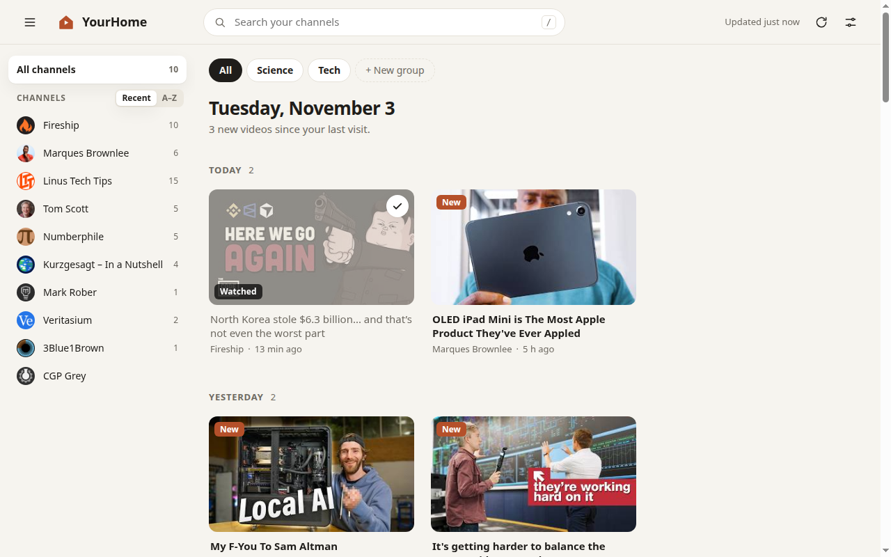

# CleanTube — YourHome

**A calm YouTube home page with only the channels you follow.**
No algorithm, no Shorts, no recommendations, no tracking. Newest first, and a clear end when you're caught up.



## Why

YouTube's home page is driven by the recommendation algorithm, and it's increasingly filled with low-effort and AI-generated videos.
YouTube does have a Subscriptions tab (`youtube.com/feed/subscriptions`), but it isn't the home page, it mixes in Shorts, and it scrolls forever.

YourHome is a page that shows *only* what the people you chose have published:

- **Only your channels**, in chronological order, grouped as Today · Yesterday · This week · Last week · Earlier.
- **No Shorts** by default (an option brings them back).
- **A finite feed.** It ends with "You're all caught up", with no infinite scroll.
- **New since your last visit** is marked, and **watched** videos fade (or can be hidden).
- **Busy channels don't take over.** A channel shows at most 2 videos per section; the rest fold into a "+N more" tile that expands in place.
- **Groups** you define (News, Music, Learning…), shown as tabs above the feed.
- **Show in Home** per channel: keep a channel without letting it flood the feed. It stays in the sidebar and on its own page.
- **Search** across titles and channels (press `/`), plus a page for each channel.
- **Layout to taste:** card size, videos per channel, open videos in a new tab, channel sort (recent or A–Z), collapsible sidebar.
- **Coming back from a video** returns you to the same spot, with the same folds open and the same "New" markers.
- Every choice is saved, and included in the backup file.
- **Optional:** open YourHome instead of the YouTube home page, and hide the recommendations next to videos.
- Light and dark themes, and it works on narrow windows.

## Install

It's a browser extension. You install it once and nothing else needs setting up: no account, no API key, no server.

**Chrome, Edge, Brave, Opera, Vivaldi**
1. Download this repository (Code → Download ZIP) and unzip it.
2. Open `chrome://extensions` and turn on **Developer mode** (top right).
3. Click **Load unpacked** and select the `extension` folder.

**Firefox** (121+)
1. Open `about:debugging#/runtime/this-firefox`.
2. Click **Load Temporary Add-on…** and pick `extension/manifest.json`.
   Temporary add-ons are removed when Firefox restarts. Permanent installation needs the add-on to be signed through addons.mozilla.org.

YourHome opens on its own after you install it. You can open it again any time from the toolbar icon.

## Adding your channels

On the first screen you can choose one of three ways:

| Way | How it works |
|---|---|
| **Import from YouTube** (one click) | Opens your subscriptions page on youtube.com and reads the list, using the sign-in you already have in this browser. It then returns to YourHome. |
| **Import a file** | Google Takeout `subscriptions.csv` ([takeout.google.com](https://takeout.google.com) → YouTube → subscriptions), OPML, NewPipe, FreeTube, or a YourHome backup. |
| **Add a channel** | Paste an `@handle`, a channel link, or a link to any of its videos. |

Running the import again only adds new channels; it never removes any.

## How it works

- Videos come from YouTube's **public RSS feeds** (`youtube.com/feeds/videos.xml`), which need no API key and have no quota.
- Shorts are filtered with no guesswork. Every channel `UCxxxx` has a playlist `UULFxxxx` that contains only its long-form videos, and YourHome reads that playlist.
- Everything is stored in the extension's local storage: your channels, the watched list and settings. Nothing is sent anywhere except the requests to youtube.com that load the feeds.
- Plain JavaScript, no build step, no dependencies. About 1,300 lines of JavaScript you can read in an afternoon.

```
extension/
  manifest.json        Manifest V3, Chrome + Firefox
  yourhome.html/.css   the page
  js/app.js            UI, refresh, settings
  js/feeds.js          RSS feeds, @handle → channel resolution
  js/importers.js      Takeout / OPML / NewPipe / FreeTube / backup files
  content/youtube.js   on youtube.com: home redirect, hide recommendations, import
  background.js        toolbar button
```

## Limits, said plainly

- RSS feeds list the **15 most recent uploads** of each channel. For channels that post several times a day, older videos within the time window may be missing.
- YouTube can change things at any time. The **RSS feeds** have been stable for many years. If the Shorts filter stops answering, YourHome notices and shows Shorts rather than an empty page. The **one-click import** reads YouTube's internal pages and is the most fragile part; the Takeout file is the reliable fallback.
- The thumbnails and links still point to YouTube. Watching a video happens on YouTube as usual.

## Status

Version 0.2. These parts were tested end-to-end in Chromium with the extension loaded: feeds and the Shorts filter, folding and expanding busy channels, groups, hiding a channel from Home, layout settings and their persistence, returning from a video, adding by handle, link, video or ID, file imports, the watched/new markers, search, the channel page, settings, the home-page redirect and its opt-out, and the light, dark and mobile layouts.
The one-click import was tried with a real account (211 channels). **Not yet tested:** Firefox. Reports are welcome.

## License

MIT
